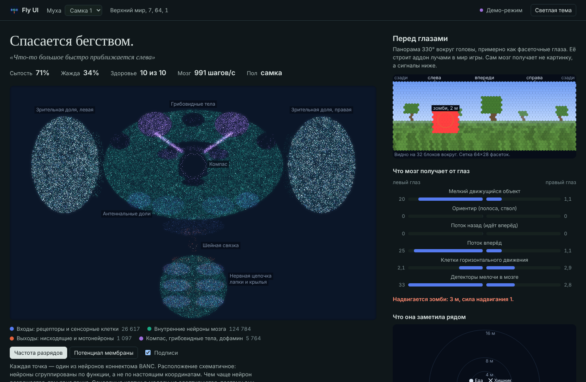

# Fly UI

Живая веб-панель для мода [Connectome Fly](https://modrinth.com/mod/flyproject-mod) в Minecraft: мозг плодовой мушки из 158 262 нейронов, её чувства, движения, зрение, компас и память в браузере, пока вы играете.



*Скриншот сделан в демо-режиме на синтетических данных.*

## Что показывает панель

- **Карту всего мозга.** Каждая из 158 тысяч точек — нейрон коннектома BANC, яркость — как часто он сейчас разряжается. Можно переключиться на мембранный потенциал. Точки сгруппированы по функции (зрительные доли, грибовидные тела, кольцо компаса, антеннальные доли, нервная цепочка), это схема, а не анатомия.
- **Что сейчас делает муха,** простой фразой, и её реплики.
- **Перед глазами:** панорама 330° вокруг головы, которую аддон строит лучами в мир, с подписанными существами и расстоянием до них.
- **Что мозг получает от глаз:** левый и правый глаз отдельно (мелкие движущиеся объекты, ориентиры, оптический поток, надвигающиеся угрозы).
- **Что она заметила рядом:** еду, хищников, воду, дом и всё остальное, что мод передаёт её мозгу.
- **Чувства и выходы мозга за последнюю минуту:** 39 входных каналов и 56 групп выходных клеток (команды поворота, гигантское волокно, мотонейроны лапок и крыльев, дофамин, клетки сна…).
- **Компас:** кольцо клеток EPG под их настоящими углами и пик активности.
- **Память, дофамин, сон, внутренние часы, сытость, жажда, здоровье,** графиками.
- **Цепи из настоящих клеток:** цепь побега (LC4, LPLC1, LPLC2 → гигантское волокно → прыжковая мышца) и цепь шага и поворота, с потенциалами и спайками.
- **Все внутренние переменные мода** с поиском и мини-графиками.

Без запущенной игры страница работает в демо-режиме на синтетических данных.

## Установка

Нужны Minecraft 1.20.1, Fabric Loader 0.15 или новее, Fabric API и мод Connectome Fly.

1. Скачайте `flyui-<версия>.jar` со страницы [Releases](https://github.com/dnocoder/fly-ui/releases) (или из артефактов последней сборки в Actions).
2. Положите его в папку `mods` той же сборки, где стоит Connectome Fly.
3. Запустите игру и войдите в мир. В чате появится ссылка, обычно это <http://127.0.0.1:8765/>.
4. Призовите муху (`/flylab spawn` или яйцо призыва) и откройте ссылку в браузере.

Если мух несколько, переключайтесь между ними списком вверху страницы.

## Настройки

При первом запуске создаётся `config/flyui.properties`:

| Параметр | По умолчанию | Что делает |
|---|---|---|
| `bind` | `127.0.0.1` | Адрес, на котором слушает страница. `0.0.0.0` откроет её всей локальной сети. |
| `port` | `8765` | Порт. Если он занят, аддон возьмёт следующий свободный из девяти. |
| `sampleHz` | `10` | Сколько снимков состояния в секунду отправлять странице (1–20). |
| `visionHz` | `4` | Кадров зрения в секунду для мухи, которую вы смотрите. |
| `visionWidth`, `visionHeight` | `64`, `28` | Сетка «фасеток» панорамы. Больше — подробнее, но дороже для сервера. |
| `visionRange` | `32` | Как далеко видят лучи, в блоках. |
| `chatLink` | `true` | Писать ли ссылку в чат при входе в мир. |

## Что здесь настоящее

Fly UI ничего не придумывает сам: он читает состояние мода Connectome Fly и показывает его. Что из этого реально, решает мод, а его авторы честно разделяют:

- **настоящее:** нейроны, кто с кем связан, сколько синапсов и знак связи (коннектом BANC v888);
- **подобрано авторами мода:** скорости нейронов, пороги, часть усилений;
- **модели:** голод, жажда, ветер, запахи и вкусы блоков, часть правил поведения.

Подробности есть в игре по команде `/flycredits`.

Две вещи в Fly UI — собственная реконструкция аддона, и на странице они так и подписаны:

- **панорама «Перед глазами»** — лучи из глаз мухи в мир игры. Мозг мухи такую картинку не получает, он получает несколько сводных зрительных сигналов, они показаны рядом;
- **расположение точек на карте мозга** — схема по функциям, а не настоящие координаты нейронов.

## Как это устроено

Аддон — небольшой мод Fabric. Он:

1. несколько раз в секунду читает состояние каждой мухи на сервере (одиночная игра тоже работает через встроенный сервер);
2. держит маленький веб-сервер на `127.0.0.1` без внешних зависимостей и отдаёт страницу из своего jar;
3. для мухи, которую вы смотрите, бросает веер лучей из её глаз и собирает панораму.

С модом Connectome Fly аддон связывается только через рефлексию по именам классов и полей. Поэтому в репозитории нет ни строчки кода этого мода и ни байта данных коннектома. Если мод обновится и что-то переименует, пропадёт только соответствующий показатель, игра не упадёт.

Страница написана на чистом HTML, CSS и JavaScript, без сборки и без внешних библиотек. Описание данных: [docs/API.md](docs/API.md).

## Сборка

**Через Gradle** (нужен доступ в интернет к Maven Fabric):

```sh
cd addon
gradle build
# jar: addon/build/libs/flyui-0.1.0.jar
```

Каждый push собирается в GitHub Actions. Тег `v*` выпускает релиз с jar.

**Без Gradle и интернета,** из jar-файлов, которые уже есть в установленной игре:

```sh
MC_JAR=<instance>/.minecraft/.fabric/remappedJars/minecraft-1.20.1-<loader>/client-intermediary.jar \
LOADER_JAR=<libraries>/net/fabricmc/fabric-loader/<version>/fabric-loader-<version>.jar \
FABRIC_API=<instance>/.minecraft/mods/fabric-api-<version>+1.20.1.jar \
BRIGADIER=<libraries>/com/mojang/brigadier/1.1.8/brigadier-1.1.8.jar \
tools/build-local.sh
```

Код вызывает Minecraft по промежуточным именам (`class_1297` и т. п.) — тем же, что игра использует под Fabric. Рядом с каждым вызовом в комментариях стоят понятные имена из yarn.

**Только страница:** откройте `web/index.html` через любой статический сервер (`python -m http.server` в папке `web`). Без игры включится демо-режим, а `?api=http://адрес:порт` подключит страницу к аддону на другом адресе. Есть также workflow `Demo page`, который публикует страницу на GitHub Pages (сначала включите Pages в настройках репозитория: Source — GitHub Actions).

## Благодарности и лицензии

- Мод [Connectome Fly](https://modrinth.com/mod/flyproject-mod) — flyproject.io, CC BY 4.0.
- Мозг мухи — коннектом BANC (Brain And Nerve Cord), выпуск v888, Codex и FlyWire. Данные остаются на условиях их авторов; Fly UI их не распространяет.
- Fly UI — лицензия MIT, см. [LICENSE](LICENSE).

---

*English, briefly:* Fly UI is a Fabric 1.20.1 addon for the Connectome Fly mod. It serves a live dashboard at `http://127.0.0.1:8765/` showing the fly's whole-brain activity (158,262 BANC neurons), sensory channels, motor outputs, a ray-cast view of what she faces, the head-direction compass, learning and every internal variable. It reads the mod by reflection only and ships none of its code or data. MIT licensed.
